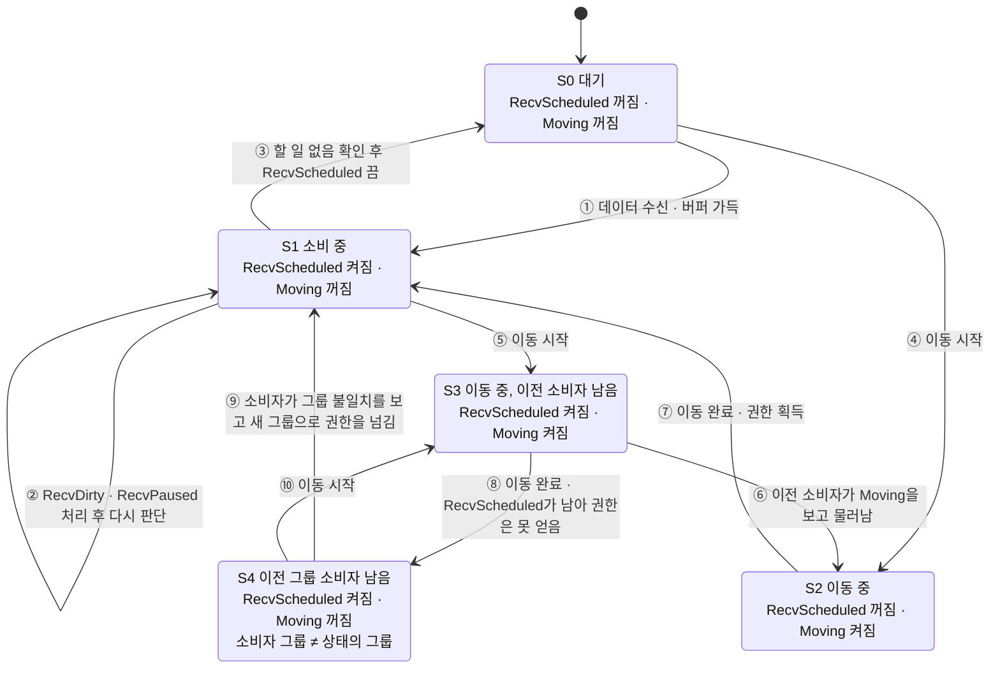
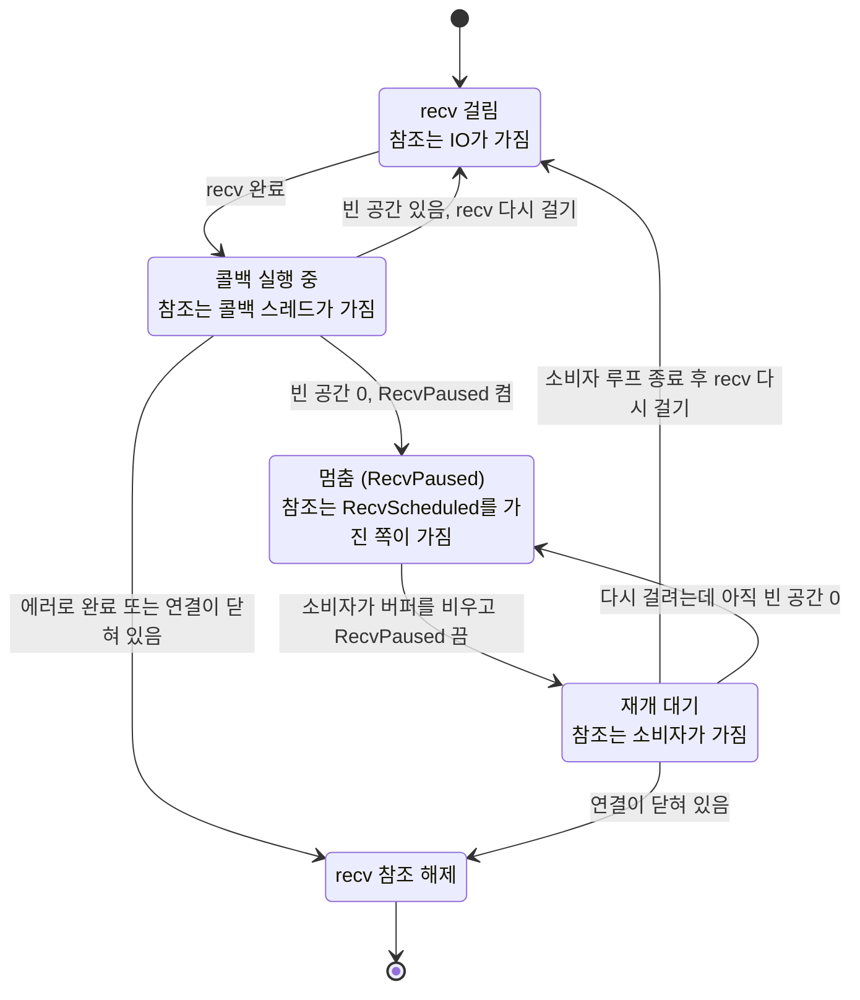

# 그룹 지연 소비 구현

## 한 줄 사실

기존 Recv 버퍼가 가득차지 않고, 가득 차면 끊는다고 가정한 수신 구조에서,버퍼가 가득 찼을 때의 크래시와 그룹 이동 중 남은 데이터의 방치를 확인하고, 소비자·할 일·이동·멈춤 상태와 그룹 ID를 64비트 원자 변수 하나로 묶어 CAS로 전이시키는 구조로 바꾸기로 했다.

## 상황

* NetLib 세션은 recv를 하나만 걸고, 그룹에 속한 세션의 패킷은 IO 스레드가 아니라 그룹 스레드가 **나중에** 소비한다(지연 소비).
* 과거 문제 자체는 알고 있었으나, 서버 입장에서 수신 패킷 처리 못하는 상황에선 연결 끊어야 한다고 생각했다. (과부하라 판단) 
* 더미 클라이언트도 같은 세션 코드를 쓰고, 서버에서 큰 데이터를 보내 버퍼가 가득 차는 일은 문제가 아니라고 판단해 수정하기로 했다.
* 그룹 큐에 update 요청 보낼 때 CAS와 RecvDirty 표시로 단일 실행 보장이 가능하다는 걸 알게 되었고, 같은 패턴을 세션 수신에도 쓸 수 있겠다 싶었음. 이 패턴의 락 대비 비용은 [CAS 구현 비교 카드](../2026-10-13_cas-state-machine/README.md)에서 측정했다.

## 이해에 필요한 배경

### 용어

| 용어 | 뜻 |
|---|---|
| 소비 | recv 버퍼에서 완성된 패킷을 꺼내 콘텐츠 콜백(`OnRecv`)을 호출하는 일 |
| 소비자 | 지금 소비 권한(`RecvScheduled`)을 가진 실행 흐름. 세션당 최대 하나여야 한다 |
| Base 그룹 | 그룹 ID 0. 전용 그룹이 없는 상태. IO 스레드가 바로 소비한다 |
| 그룹 job | 그룹의 작업 큐에 들어가는 작업. Enter, Leave, Recv가 있다 |
| recv 참조 | 세션 참조 카운트 중 "recv를 걸어 둔 상태"가 가지고 있는 1개 |

### 세션 수명은 참조 카운트로 관리한다

* 세션 객체는 IOCP가 가진 고정 배열의 한 칸이다.
* 참조 카운트(`_refCount`)가 0이 되면 세션이 해제되고, 그 칸은 나중에 다른 연결이 재사용한다.
* 참조를 올리는 곳은 recv를 걸 때(`RegisterRecv`), send를 걸 때, `FindSession`으로 찾을 때다. 내리는 곳은 `Release`다.
* 세션이 살아있는 동안 Recv 항상 걸려있으므로, 참조 카운트를 매번 변경하지 않고 항상 1로 둔다. Recv가 실패할 때만 내린다.

### 그룹은 자기 작업을 한 번에 하나씩 실행한다

그룹은 작업 큐를 가지고 있다. 작업은 IOCP 워커 스레드에서 실행되지만 **같은 그룹의 작업은 동시에 두 개가 실행되지 않는다**. 이 흐름을 "그룹 스레드"라고 부른다.

그룹에 속한 세션의 패킷은 그룹 스레드가 처리해야 한다. 그래서 데이터가 도착하면 IO 스레드는 그룹 큐에 Recv job을 넣고, 실제 소비는 나중에 그룹 스레드가 한다.

### 코드베이스의 동일한 패턴

`Group::RequestUpdate`/`Update`는 여기서 만들 구조와 같은 원리로 동작한다.

| 그룹 실행 상태 | 이 문서의 대응 |
|---|---|
| Idle | 소비자 없음 |
| Scheduled / Running | 소비자 있음 (RecvScheduled) |
| RunningDirty | 소비자가 돌고 있는데 새 일이 생김 (RecvDirty) |

`Update`는 끝내기 전에 CAS로 "Running → Idle"을 시도하고, 실패하면(누가 RecvDirty로 바꿨으면) 한 번 더 돈다. 세션의 소비자 루프도 똑같이 동작한다.

### 세션은 그룹 사이를 이동한다

`GroupManager::MoveSession(세션, 목적지)`는 다음 일을 한다.

1. 이전 그룹 큐에 Leave job을 넣는다 → 나중에 이전 그룹이 `OnLeave`를 호출한다.
2. 세션의 그룹 ID를 목적지로 바꾼다.
3. 목적지 그룹 큐에 Enter job을 넣는다 → 나중에 목적지 그룹이 `OnEnter`를 호출한다.

이동은 보통 콘텐츠의 `OnRecv` 안에서 요청된다. 예: "필드 입장" 패킷을 받으면 필드 그룹으로 이동한다.

## 문제

### 문제 A. 버퍼가 가득 차면 죽거나 끊긴다

지연 소비 때문에 그룹이 바쁘거나 클라이언트가 한꺼번에 많이 보내면 언제든 버퍼가 가득 찰 수 있다. Debug에서는 죽고, Release에서는 길이 0 버퍼로 recv를 건다.

### 문제 B. 이동하면 데이터가 방치된다

| 시점 | 일 |
|---|---|
| T1 | 세션은 그룹 A. 데이터가 도착해 A 큐에 Recv job이 들어간다 |
| T2 | A가 job을 실행하기 전에 세션을 B로 옮긴다. 그룹 ID = B |
| T3 | A가 job 실행 → `RecvHandler`가 "그룹이 다르다"며 바로 빠진다 |
| T4 | B가 Enter job 실행 → `OnEnter`만 호출한다. 버퍼의 데이터는 그대로 남는다 |

이 데이터는 **다음 패킷이 도착할 때까지** 아무도 처리하지 않는다. 클라이언트가 응답을 기다리며 아무것도 보내지 않으면 영원히 남는다.

### 문제 C. "소비자는 하나"라는 보장을 확장할 수 없다

기존 `_isHandled`는 "그룹 큐에 Recv job이 있다"만 표현한다. 이동 중이라 지금은 아무도 소비하면 안 된다거나 recv가 멈춰 있다는 상황은 표현할 수 없다. 문제 A와 B를 고치려면 이런 상황을 표현해야 해서 플래그 하나로는 부족하다.

그룹 세션은 완료 콜백이 Recv job만 넣고 바로 다음 recv를 걸고, `_isHandled`는 job이 실행을 시작할 때 꺼진다. 그래서 `OnRecv`가 도는 동안에도 새 데이터가 도착해 Recv job이 생길 수 있다. 이때 외부 스레드(DB 콜백, 다른 그룹이나 세션 등)가 `MoveSession`으로 세션을 이동시키면 두 스레드가 같은 버퍼를 읽는다. 이 문제는 외부에서 강제로 이동시키는 경우가 없을 것으로 가정했었으나, 미리 수정해두는 것이 좋을 것 같다. 

| 시점 | 그룹 A 스레드 | 외부 스레드 / IO 스레드 | 그룹 B 스레드 |
|---|---|---|---|
| T1 | Recv job 실행. `RecvHandler` 루프에서 그룹 ID가 A인지 확인하고 통과 | | |
| T2 | | 외부 스레드가 `MoveSession(B)`로 그룹 ID를 B로 바꿈 | |
| T3 | | 새 데이터 도착. `_isHandled`가 꺼져 있어 B 큐에 Recv job을 넣음 | |
| T4 | 확인은 이미 통과했으므로 그대로 `Peek`, `Dequeue`로 패킷을 읽음 | | `RecvHandler(B)`가 그룹 ID 확인을 통과하고 같은 버퍼를 읽음 |

## 해결 방향

> 버퍼가 가득 차면 recv를 멈춘다.  그룹에 스케줄링 되었는지만 확인하던 bool 플래그 대신 moving도 표현 가능한 bitflag로 수정한다.

| 문제 | 해결 |
|---|---|
| A. 버퍼 가득 | `RecvPaused` 플래그로 recv를 멈추고, 소비자가 버퍼를 비운 뒤 재개한다 |
| B. 이동 중 방치 | 이동하는 동안은 아무도 소비하지 않는다(Moving). 이동이 끝나면 새 그룹에서 소비를 시작한다 |
| C. 표현력 부족 | 소비자 존재, 할 일, 이동 중, recv 멈춤, 현재 그룹을 **원자 변수 하나**에 담는다 |

### 문제 A를 recv 멈춤으로 푼 이유

* 한꺼번에 큰 패킷이 몰려오는 쪽은 주로 서버 → 클라이언트 방향이다. 이 방향은 recv를 늦게 걸어도 문제가 적다고 판단했다.
* 클라이언트 → 서버에서 버퍼가 가득 찼다는 것은 서버가 느리다는 뜻이다. 이 경우에는 패킷을 처리한 뒤에 recv를 거는 쪽이 맞다고 판단했다.
* recv를 걸지 않으면 커널 소켓 버퍼가 차고 TCP 흐름 제어로 상대가 전송을 늦춘다.

**검토했지만 하지 않은 것:** 별도 패킷 메모리를 두고, 수신하자마자 recv 큐에서 빼서 복사 후 바로 다음 recv를 거는 방식.
부하가 있고, 처리할 수 있는 만큼만 받으며 recv를 다시 거는 쪽이 낫다고 판단해 택하지 않았다.

## 알려진 한계

* 이동 완료 전에 이동이 새로 들어오면 지연 처리된다. 여러 개 지연되면 실행 순서는 보장되지 않는다. 순서가 중요한 콘텐츠라면 콘텐츠 쪽에서 이동 요청을 정리해야 한다.
* 핸들러가 가득 찬 버퍼를 전혀 소비하지 못하면서 세션도 닫지 않으면, Base 그룹에서 `ProcessRecv` → `RecvNotIncrease` → `ProcessRecv` 재귀가 될 수 있다. 지금은 버퍼보다 큰 패킷이면 세션을 닫기 때문에 실제로는 생기지 않는다.

## 구현 세부

아래는 이 구조의 구현 디테일이다. 

### 상태 정의

| 비트 | 63 ~ 32 | 31 ~ 4 | 3 | 2 | 1 | 0 |
|---|---|---|---|---|---|---|
| 내용 | 그룹 ID | 사용 안 함 | RecvPaused | RecvDirty | RecvScheduled | Moving |

| 플래그 | 켜져 있으면 |
|---|---|
| **RecvScheduled** | 세션 처리가 스케줄링 됐거나 실행 중. 이 플래그를 가진 쪽만 recv 버퍼를 읽는다(코드는 "소비 권한"이라 부른다) |
| **RecvDirty** | 버퍼를 다시 확인해야 함. 데이터가 추가되었을 수 있음 |
| **Moving** | 그룹 이동 중. 아무도 소비하면 안 되고 새 소비자도 만들면 안 된다 |
| **RecvPaused** | 버퍼가 가득 차 recv를 걸지 않음 |

### 상태 머신

**소비 상태 머신**은 소비중인지, 이동 중인지 정보. 
**recv 상태 머신**은 recv가 걸려 있는지 아닌지. 
RecvDirty는 "할 일 있음" 표시로 양쪽에서 사용.

#### 소비 상태 머신

S1과 S4는 플래그가 같다. 차이는 소비자가 실행되는 그룹과 상태에 기록된 그룹 ID가 같으냐 다르냐뿐이어서 상태 변수만 보고는 구분할 수 없다. 소비자가 실행될 때 자기 그룹과 상태의 그룹 ID를 비교해서 알아낸다.

| 전이 | 일어나는 일 |
|---|---|
| ① S0 → S1 | 소비자가 없으므로 이 스레드가 RecvScheduled를 얻고 권한을 넘긴다(`HandOffRecvTo`) |
| ④ S0 → S2 | Moving을 켜고 그룹 ID를 목적지로 바꾼다 |
| ⑤ S1 → S3 | 소비자가 남아 있는 채로 이동이 시작된다 |
| ⑦ S2 → S1 | `CompleteMove`가 Moving을 끄고, 소비자가 없으므로 RecvScheduled도 함께 켜서 새 그룹으로 권한을 넘긴다(`HandOffRecvTo`) |
| ⑧ S3 → S4 | Moving은 꺼지지만 이전 소비자가 RecvScheduled를 쥐고 있어 새 소비자를 만들지 못한다. RecvDirty는 이동을 시작할 때(`TryBeginMove`) 이미 켜져 있다 |
| ⑩ S4 → S3 | 이전 소비자가 남은 채로 또 이동이 시작된다 |

소비자가 직접 일으키는 전이(② ③ ⑥ ⑨)는 아래 소비자 판단 순서의 각 단계다. ②는 3·4단계, ③은 5단계, ⑥은 1단계, ⑨는 2단계에 해당한다.

이동 중(S2, S3, S4)에 이동 요청이 또 오면 지금 처리하지 않고 나중에 다시 시도한다(첫 이동의 완료가 둘째 이동의 Moving을 꺼 버리기 때문이다). 데이터 도착과 버퍼 가득은 어느 상태에서나 RecvDirty(와 RecvPaused)만 켜고 끝난다.

#### recv 상태 머신

#### 소비자 판단 순서

소비자는 루프를 돌 때마다 위에서부터 처음으로 맞는 조건 하나만 처리한다. 순서를 바꾸면 안 된다.

| 순서 | 조건 | 상태 변경 | 그다음 |
|---|---|---|---|
| 1 | Moving이 켜져 있다 | +RecvDirty −RecvScheduled | 루프 종료. 이동이 끝나면 새 소비자가 생긴다 |
| 2 | 그룹 ID ≠ 지금 실행 중인 그룹 | +RecvDirty  | 해당 그룹으로 권한을 넘기고(`HandOffRecvTo`) 루프 종료 |
| 3 | RecvDirty가 켜져 있다 | −RecvDirty | 패킷을 처리하고 다시 판단 |
| 4 | RecvPaused가 켜져 있다 | −RecvPaused | 다시 판단. **루프가 끝난 뒤** recv를 다시 건다 |
| 5 | 위 어느 것도 아니다 | −RecvScheduled (CAS) | 루프 종료 |

- 권한 위임할 그룹이 base인 경우 큐가 없으므로 바로 실행한다.

### 이 구조는 어떻게 만들어졌나

그룹 update 패턴에서 출발해 지연 소비, 그룹 이동, 세션 참조 문제를 차례로 더해 간 과정은 [어떻게-만들어졌나.md](어떻게-만들어졌나.md)에 따로 정리했다.
