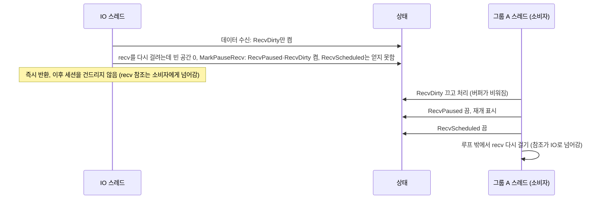
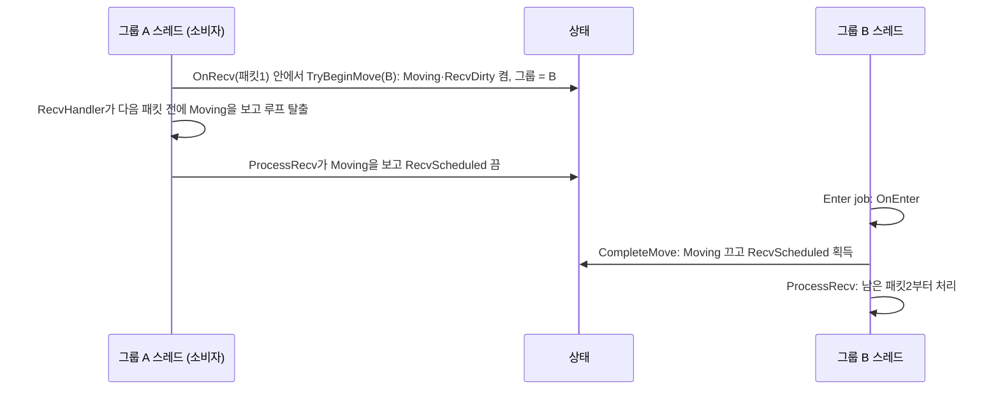
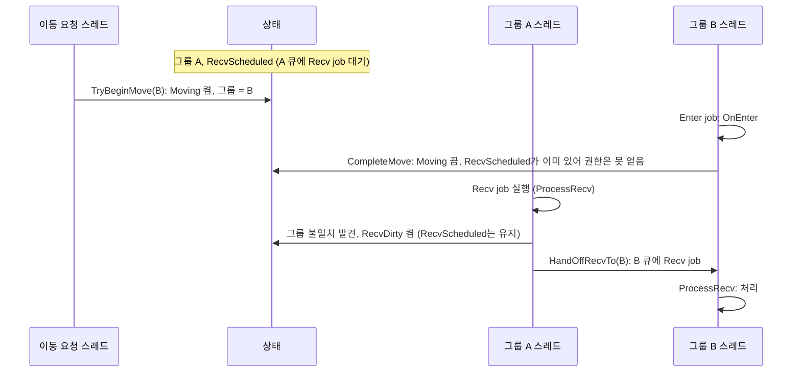

# 세션 수신 구조는 어떻게 만들어졌나

NetLib의 세션 수신 구조는 상태 변수 하나에 플래그 네 개와 그룹 ID를 담고, CAS로만 바꾼다. 이 글은 그 구조를 처음부터 쌓아 올리는 순서로 설명한다.

각 단계는 앞 단계 위에서 새 문제가 생기고, 그 문제를 푸는 방식으로 이어진다. 실제 개발 순서를 기록한 글은 아니다. 설계의 논리적 순서로 다시 구성했다.

글에서 "소비자"는 코드에 없는 설명용 말이다. RecvScheduled(소비 권한)를 가진 쪽을 뜻한다. "소비"는 recv 버퍼에서 패킷을 꺼내 `OnRecv`를 호출하는 일이다.

## 1. 출발점: 그룹 update는 한 번에 하나만 돈다

코드베이스에는 이미 같은 문제를 푼 코드가 있다. `Group::RequestUpdate`와 `Group::Update`다. 상태는 Idle, Scheduled, Running, RunningDirty 네 개다. 핵심은 하나다. **update는 한 번에 하나만 실행한다.**

일이 생겼을 때 이미 update가 예약돼 있거나 돌고 있으면 새로 만들지 않는다. Dirty 표시만 남긴다. 표시가 필요한 이유가 있다. 실행하는 쪽이 "할 일 없음"을 확인한 직후에 도착한 일을 놓치지 않으려는 것이다.

실행하는 쪽은 Dirty를 **처리하기 전에** 끈다(`_updateState.store(Running)` 후 `Process()`를 한 번 더 돈다). 처리한 뒤에 끄면 처리 도중 켜진 표시까지 지워 버린다.

끝낼 때는 Running에서 Idle로 가는 CAS를 한 번 한다. "할 일 없음 확인"과 "Idle로 되돌리기"가 한 동작이다. 따로 하면 그 사이에 끼어든 일을 놓친다. CAS가 실패하면 누군가 Dirty를 켰다는 뜻이다. 한 번 더 돈다.

이 패턴이 뒤에 나오는 모든 것의 뼈대다.

## 2. 같은 패턴을 세션 recv에 적용한다

### 지연 소비와 소비자

세션의 recv 버퍼는 링 버퍼다. 읽는 쪽이 하나일 때만 안전하다. 그룹에 속한 세션은 패킷을 IO 스레드가 아니라 그룹 스레드가 나중에 소비한다(지연 소비). 읽는 쪽을 하나로 만들어야 하므로, 그룹 update의 패턴을 그대로 가져왔다.

| 그룹 update | 세션 recv |
|---|---|
| Scheduled / Running | RecvScheduled (소비 권한) |
| RunningDirty | RecvDirty |
| Idle | 둘 다 꺼짐 |

"실행 중"만 소비자로 치면 안 된다. 큐에 예약만 된 job도 소비자로 쳐야 한다. 아니면 이동 직전과 직후에 각각 job이 다른 그룹 큐에 들어가고, 두 그룹 스레드가 같은 버퍼를 동시에 읽는다.

데이터가 도착하면 IO 스레드는 RecvDirty를 켠다. 소비 권한이 비어 있으면 같은 CAS에서 RecvScheduled도 켜고 해당 그룹에 넘긴다. 이미 소비자가 있으면 표시만 남기고 끝난다. 그룹 update와 똑같이 소비자는 Dirty를 처리 전에 끄고, 끝낼 때 CAS 한 번으로 RecvScheduled를 끈다.

### 버퍼가 가득 차면: RecvPaused

지연 소비의 부작용이 있다. 그룹이 바쁘면 소비가 밀리고 recv 버퍼가 가득 찰 수 있다. 가득 찬 채 recv를 걸면 Debug에서는 크래시, Release에서는 길이 0 recv가 된다.

그래서 빈 공간이 0이면 recv를 걸지 않고 RecvPaused를 켠다. 소비자가 버퍼를 비우면 RecvPaused를 끄고 recv를 다시 건다. 커널 소켓 버퍼가 차면 TCP 흐름 제어가 상대의 전송을 늦춘다.

여기서 CAS 하나가 더 필요해진다. 버퍼가 가득 찼을 때 소비자가 없을 수 있다. "RecvPaused 켜기"와 "소비 권한 얻기"를 따로 하면, 그 사이에 기존 소비자가 끝나 버릴 수 있다. 그러면 RecvPaused를 아무도 보지 못하고 recv는 영영 재개되지 않는다.

그래서 `MarkPauseRecv`는 RecvPaused와 RecvDirty를 켜면서 가능하면 RecvScheduled도 같은 CAS로 켠다. 결과는 둘 중 하나다.

* 내가 소비 권한을 얻는다. 내가 직접 비우고 재개한다.
* 이미 소비자가 있다. 그 소비자가 RecvPaused를 본다.

소비자가 있을 때 버퍼가 가득 차면 이런 순서가 된다.

recv 재개를 언제, 누가 하는지는 4절에서 다시 다룬다. 세션 참조 수명이 얽혀 있기 때문이다.

## 3. 그룹 이동을 추가한다

세션은 그룹 사이를 이동한다. `OnRecv` 안에서 "필드 입장" 같은 패킷을 받고 필드 그룹으로 옮기는 식이다. 이동이 들어오면 위의 구조에서 몇 가지가 부족해진다.

### Moving: 이동하는 동안 아무도 소비하지 않는다

이동 중에는 목적지 그룹이 `OnEnter`보다 먼저 패킷을 받으면 안 된다. 출발 그룹의 소비자가 아직 돌고 있을 수도 있다. 목적지에서 새 소비자를 만들면 둘이 동시에 버퍼를 읽는다.

그래서 Moving 플래그를 만들었다. Moving이 켜져 있으면 소비도 하지 않고 새 소비자도 만들지 않는다. 이동이 끝나는 시점(`CompleteMove`)에 Moving을 끄고 소비 권한을 얻는다. 이동 중에 쌓인 데이터는 새 그룹이 `OnEnter` 다음에 처리한다.

Moving이 없으면 이렇게 된다.

| 시점 | IO 스레드 | `MoveSession` 호출 스레드 | 그룹 B 큐 |
|---|---|---|---|
| 1 | | 그룹 ID를 B로 바꿈 | |
| 2 | 패킷 수신. 소비자 없음, B 큐에 Recv job | | Recv |
| 3 | | B 큐에 Enter job | Recv, Enter |

그룹 B는 Recv를 먼저 실행한다. `OnEnter`보다 패킷을 먼저 받는다.

Moving을 두면 흐름이 이렇게 바뀐다. `OnRecv` 안에서 이동을 요청하는 가장 흔한 경우다. 같은 묶음의 다음 패킷은 이전 그룹이 아니라 목적지 그룹이 `OnEnter` 다음에 처리한다.

### 그룹 ID를 같은 원자 변수에 넣는다

소비 권한을 얻을 때는 "어느 그룹 큐에 job을 넣을지"도 함께 정해야 한다. 그룹 ID를 따로 두면 읽는 사이에 이동이 통째로 끝날 수 있다. 세션은 B에 있는데 소비자는 A에 생긴다.

그룹 ID가 플래그와 같은 64비트 변수에 있으면, 소비 권한을 얻는 CAS가 그룹 ID가 바뀐 것을 보고 실패한다. 다시 읽으면 B를 얻는다.

### Moving을 켜는 CAS에서 그룹 ID도 바꾼다

이동을 시작하는 CAS(`TryBeginMove`)는 Moving 켜기, RecvDirty 켜기, 그룹 ID 교체를 한 번에 한다. 그러면 "새 그룹 ID를 본 스레드는 반드시 Moving도 본다"가 성립한다. 따로 바꾸면 Moving 없이 새 그룹 ID만 보이는 순간이 생기고, 위의 표가 그대로 재현된다.

### 이동 중에 이동이 또 오면 미룬다

Moving은 진행 중인 이동 하나만 표현한다. 두 번째 이동을 바로 시작하면 첫 이동의 완료가 두 번째 이동의 Moving을 꺼 버린다. 그러면 C가 `OnEnter`보다 패킷을 먼저 받고, 이동 완료가 두 번 처리된다.

그래서 `TryBeginMove`는 Moving이 켜져 있으면 실패한다. `MoveSession`은 이 경우 executor에 다시 넣어 나중에 시도한다. 세션 자신의 패킷 처리 중에 하는 동기 이동에서는 이 상황이 생기지 않는다. 이동을 시작하면 핸들러 루프가 Moving을 보고 멈추기 때문이다. 목적지의 `OnEnter` 안에서 다시 이동하거나, DB 콜백이나 다른 세션이 이동시키는 경우에 생긴다.

### 옛 그룹 큐에서 job이 기다리는 동안 이동이 끝난다

가장 까다로운 경우다. 소비자인 A 큐의 Recv job이 큐에서 기다리는 동안 이동이 시작되고 끝난다.

`CompleteMove`는 RecvScheduled가 이미 켜져 있어 권한을 얻지 못한다. 실제 소비자는 A 큐의 job이다. 이 job이 실행되면 자신은 A인데 세션은 B다.

* 그냥 끝내면 RecvScheduled가 켜진 채 소비자가 사라진다. 이후 아무도 처리하지 않는다.
* 그냥 소비하면 A 스레드가 B 세션의 패킷을 처리한다.

그래서 이 소비자는 RecvDirty를 켜고, RecvScheduled는 **끄지 않은 채** 상태에 기록된 그룹으로 권한을 넘긴다(`HandOffRecvTo`). 권한이 한 번도 풀리지 않고 옮겨 가므로 중간에 다른 소비자가 끼어들 틈이 없다.

### 소비자 루프의 판단 순서

이제 소비자(`ProcessRecv`)가 판단할 것이 늘었다. 루프를 돌 때마다 상태를 한 번 읽고, 처음 맞는 조건 하나만 처리한다.

1. Moving이 켜져 있다. RecvDirty를 켜고 RecvScheduled를 끄고 물러난다. 이동이 끝나면 새 소비자가 생긴다.
2. 상태의 그룹과 실행 중인 그룹이 다르다. 위에서 본 권한 넘기기다.
3. RecvDirty가 켜져 있다. 끄고 패킷을 처리한다.
4. RecvPaused가 켜져 있다. 끄고, 루프가 끝난 뒤 recv를 다시 건다.
5. 아무것도 아니다. CAS로 RecvScheduled를 끄고 끝낸다.

Moving 확인이 그룹 비교보다 앞이어야 한다. 그룹 비교만으로는 이동 중인지 알 수 없다. 이동 목적지가 지금 실행 중인 그룹과 같을 수 있다. 예를 들어 A 큐의 job이 대기하는 동안 A에서 B로, 이어서 B의 `OnEnter`가 요청한 B에서 A로 이동이 일어나면, 옛 job이 실행될 때 그룹 ID와 실행 그룹이 우연히 같다. 그룹 비교를 먼저 하면 통과해서, A의 `OnEnter`(재입장)가 실행되기 전에 소비해 버린다.

물러나거나 넘기는 경로는 모두 RecvDirty를 켠다. 이것만 지키면 남은 데이터는 반드시 누군가가 처리한다.

## 4. 지연 소비가 만든 참조 문제

지연 소비 때문에 recv 참조가 누구에게 있는지가 복잡해졌다. 세션 객체는 고정 배열의 한 칸이다. 참조 카운트가 0이 되면 해제되고, 그 칸은 다른 연결이 재사용한다. recv를 걸어 둔 상태는 참조 1개를 갖는다. 그 참조가 지금 어디에 있는지 항상 하나로 정해져 있어야 한다.

| 지금 상황 | recv 참조를 가진 쪽 |
|---|---|
| recv가 걸려 있다 | 걸린 IO |
| recv 완료 콜백이 실행 중이다 | 콜백 |
| RecvPaused | RecvScheduled를 가진 소비자 |

참조가 없는 쪽은 세션을 건드리면 안 된다. 이 원칙에서 세 가지가 따라 나온다.

### 권한을 못 얻었으면 즉시 손을 뗀다

콜백이 버퍼가 가득 차 RecvPaused를 켰는데 RecvScheduled를 얻지 못했다면, recv 참조는 기존 소비자에게 넘어갔다. 이 스레드에는 남은 참조가 없다. 더 만지면 안 된다.

| 시점 | IO 스레드 | 그룹 스레드 | 참조 수 |
|---|---|---|---|
| T1 | 완료 콜백 실행 (recv 참조 소유) | | 1 |
| T2 | RecvPaused 켬, RecvScheduled 못 얻음. 참조를 넘김 | | 1 |
| T3 | | Recv job 실행, `FindSession` | 2 |
| T4 | | 소비 후 RecvPaused 끔. recv를 다시 걸려는데 연결이 닫혀 있어 recv 참조 해제 | 1 |
| T5 | | job 종료, 해제, 0이 되어 세션 해제. 칸 재사용 | 0 |
| T6 | (손을 떼지 않았다면) 세션 상태를 건드림. **다른 연결의 상태**를 망가뜨림 | | |

RecvScheduled를 얻은 경우는 반대다. 그 스레드가 RecvPaused를 풀 수 있는 유일한 쪽이라 참조를 쥐고 있는 셈이다. 콜백 전체를 참조 증가와 감소로 감싸는 대안도 있다. 패킷마다 원자 연산이 2번 늘어나서 택하지 않았다.

따라서 recv 참조만 가진 코드는 참조를 넘기거나 내리는 동작을 함수의 마지막에 해야 한다. `RecvNotIncrease`의 주석이 이 원칙을 적어 둔 곳이다.

### recv 재개는 소비자 루프의 맨 마지막에

소비자가 RecvPaused를 끄면 그 순간부터 소비자가 recv 참조를 가진다. recv를 거는 순간 그 참조는 IO로 넘어간다. 루프 도중에 걸면 그 recv가 곧바로 실패하거나 취소돼 참조가 0이 될 수 있다. 그런데 루프는 계속 세션을 만진다.

그룹 스레드에서 도는 소비자는 job이 `FindSession`으로 잡은 참조가 따로 있어 괜찮다. 문제는 IO 스레드에서 바로 실행된 Base 소비자다. 버퍼가 가득 차서 직접 소비자가 된 경우인데, 따로 잡은 참조가 없다.

그래서 `ProcessRecv`는 판단 4에서 재개 표시(`resumeRecv`)만 하고, 루프가 끝난 뒤 마지막에 recv를 건다. 거는 순간까지는 이 소비자가 참조를 쥐고 있고, 건 뒤에는 아무것도 하지 않는다.

### recv를 건 뒤 `_connect`를 다시 확인한다

마지막 구멍이 하나 남는다. `Close()`는 `_connect = false`를 먼저 하고 걸린 IO를 취소한다. 그런데 recv를 거는 쪽이 `_connect`를 확인한 직후, recv를 걸기 직전에 `Close()`가 끼어들면, 취소할 IO가 아직 없다. 그 뒤에 걸린 recv는 닫힌 세션에 남는다.

| 시점 | IO를 거는 스레드 | `Close()` 스레드 |
|---|---|---|
| T1 | `_connect` 확인: true | |
| T2 | | `_connect = false` |
| T3 | | 걸린 IO 취소: 아직 안 걸려서 취소할 것이 없음 |
| T4 | recv 걸기 → Pending | |
| 결과 | 닫힌 세션에 recv가 남아 해제되지 않는다 | |

그래서 recv가 Pending이면 `_connect`를 다시 확인한다. false면 세션을 닫는다. 두 쪽의 순서가 서로 반대라서 어느 순서로 실행되든 한쪽은 상대의 변경을 본다.

이 시점에는 이미 recv 참조가 IO로 넘어갔다. 확인하는 사이 세션이 해제되고 재사용됐을 수 있다. 그래서 세션 포인터가 아니라 **IO를 걸기 전에 읽어 둔 세션 ID**로 찾아 닫는다(`DisconnectSession(beforeSessionId)`). 재사용됐다면 우리가 건 IO는 이미 끝난 것이고, ID가 달라서 다른 연결을 닫지도 않는다. 앞 절의 "넘긴 뒤에는 건드리지 않는다"에서 유일한 예외다.

## 정리

| 단계 | 추가한 것 | 풀려는 문제 |
|---|---|---|
| 1 | Dirty 표시, CAS 한 번 | 한 번에 하나만 실행 |
| 2 | RecvScheduled, RecvDirty, RecvPaused | 읽는 쪽 하나 보장, 버퍼 가득 참 |
| 3 | Moving, 그룹 ID, 권한 넘기기 | 이동 중 방치와 이중 소비 |
| 4 | 참조 위치 규칙 | 지연 소비 때문에 복잡해진 세션 수명 |
